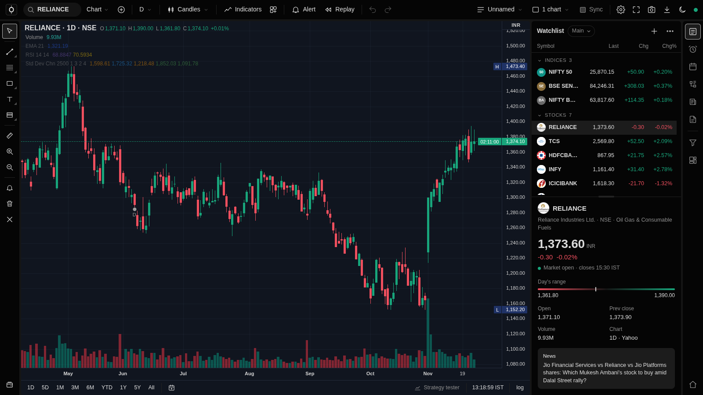
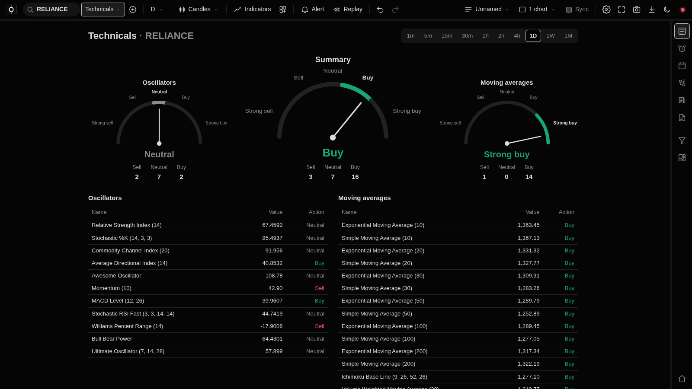
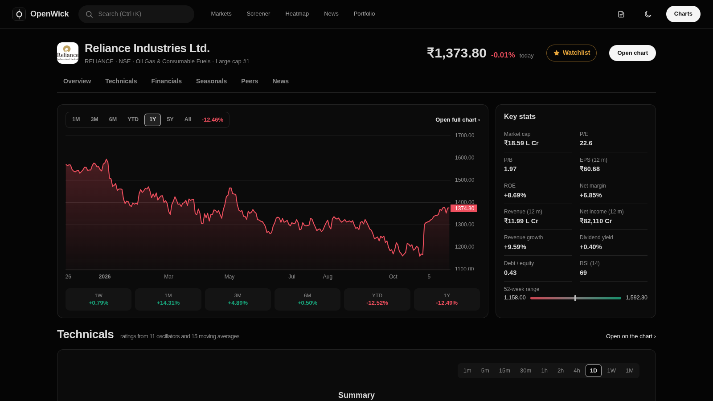
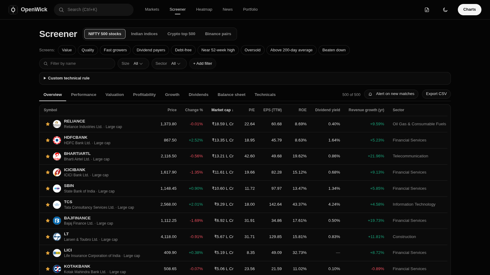
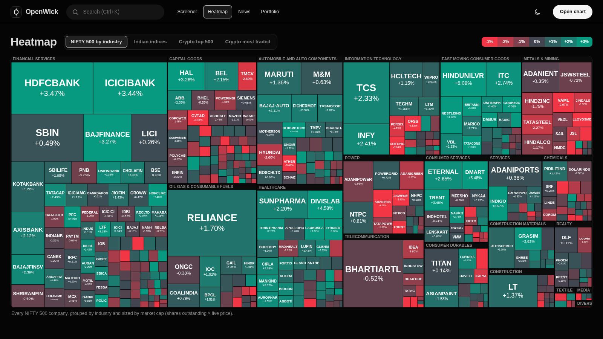
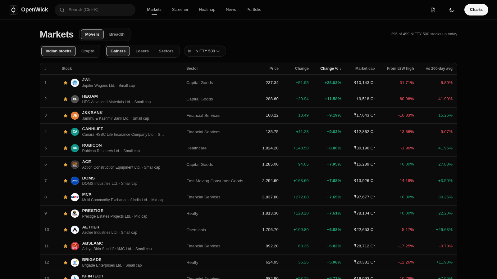
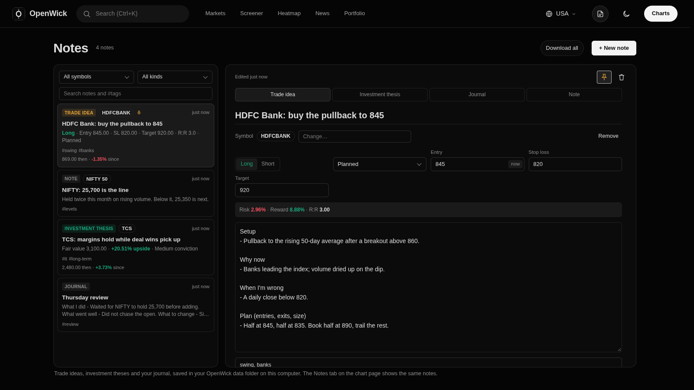

# OpenWick

A free trading terminal for stocks, indices and crypto that runs on your own computer, for six markets: the USA, the UK, Germany, Japan, Hong Kong and India. Charts, 89 indicators, 25 drawing tools, alerts, a screener with alerts, a heatmap, market movers and breadth for every index, trading notes, a portfolio page, company financials, economic calendars, market and crypto news, seasonals, a strategy tester with quant checks, bar replay and paper trading. No account, no subscription, no ads, no limit on indicators per chart.

It's one small Node.js app with no dependencies. Your watchlists, drawings, alerts and paper account are plain files in a data folder on your machine.

Created by **Sourav Chakraborty**. Open source under the MIT licence.



## Countries

Pick a country from the globe in the top bar. The home page, Markets, Screener, Heatmap, News and calendar then show that market; crypto is on every country's pages. It's guessed from your time zone the first time, and remembered. A link with `?country=US` opens that market.

| Country | Main stock list | Indices | Currency |
|---|---|---|---|
| USA | S&P 500 + Nasdaq-100 (518 stocks) | S&P 500, Nasdaq Composite, Nasdaq-100, Dow Jones, Russell 2000, VIX, the 11 sector funds | $ |
| UK | FTSE 350 | FTSE 100, FTSE 250, FTSE All-Share | £ (London prices are in pence) |
| Japan | Nikkei 225 | Nikkei 225, TOPIX (through its biggest fund) | ¥ |
| Germany | DAX and MDAX | DAX, MDAX, SDAX, TecDAX | € |
| Hong Kong | Hang Seng Index | Hang Seng, Hang Seng TECH, HS China Enterprises | HK$ |
| India | NIFTY 500 | NIFTY 50, SENSEX, BANK NIFTY and 34 more | ₹ (crore and lakh crore) |

Every country gets the same pages: movers and breadth, the screener with company figures (P/E, margins, growth, debt…), the heatmap, stock pages with financials, peers and news, its economic calendar, and charts with that exchange's hours (including Tokyo's and Hong Kong's lunch breaks), countdown and session shading. Charts, watchlists, notes and alerts work for any symbol whichever country is picked.

**What's downloaded, and when.** The name lists for every country come with the app (about 150 KB in all). A country's company figures (about 1 MB) and logos download in the background the first time you open it, and refresh weekly while you keep using it. A country you haven't opened for 30 days has its figures and logos deleted; they come back the next time. Prices are never saved.

| | |
|---|---|
|  |  |
| **Technical ratings**: oscillators and moving averages, on any timeframe | **Company pages**: price, key stats, technicals, financials, seasonals |
|  |  |
| **Screener**: NIFTY 500, indices and crypto, with ready-made screens | **Heatmap**: every NIFTY 500 company by industry and size |
|  |  |
| **Markets**: today's gainers, losers and sectors, and breadth for every index | **Notes**: trade plans with risk and reward, investment theses and a journal |

## Install

**Desktop app.** Download the installer for your computer from the [latest release](https://github.com/openwickhq/OpenWick/releases/latest) and open it:

| Computer | File |
|---|---|
| Windows | `OpenWick-…-win-x64.exe` |
| Mac with an Apple chip (M1 or later) | `OpenWick-…-mac-arm64.dmg` |
| Mac with an Intel chip | `OpenWick-…-mac-x64.dmg` |
| Linux | `OpenWick-…-linux-x86_64.AppImage`, or `.deb` for Ubuntu and Debian |

It installs for your user only, with no admin rights. The app checks for a new version when it starts and offers to open the download page; your charts and settings are kept when you install over it. Your data lives in your user folder (Help → Open data folder), not in the app's folder.

The installers aren't code-signed yet, so the first time:
- **Windows** may show "Windows protected your PC". Click **More info**, then **Run anyway**.
- **macOS** may say the app "can't be opened" or "is damaged". Right-click (Control-click) the app in Applications and choose **Open**, or run `xattr -cr /Applications/OpenWick.app` in Terminal once.
- **Linux AppImage:** make it runnable first (`chmod +x OpenWick-*.AppImage`).

**Or the one-command install**, which runs OpenWick in your browser instead of its own window. One command. No admin rights, no account, nothing else to set up. If you don't have Node.js, the installer fetches its own copy just for this app.

**macOS and Linux** (in Terminal):

```bash
curl -fsSL https://raw.githubusercontent.com/openwickhq/OpenWick/main/install.sh | sh
```

**Windows** (in PowerShell):

```powershell
irm https://raw.githubusercontent.com/openwickhq/OpenWick/main/install.ps1 | iex
```

It installs into your home folder (`~/.openwick`, or `%LOCALAPPDATA%\OpenWick` on Windows), adds an **OpenWick** entry to your app menu (Start menu and desktop on Windows), and opens the app in your browser.

After that:

| Command | What it does |
|---|---|
| `openwick` | Start it and open your browser (or just open the browser if it's running) |
| `openwick stop` | Stop it |
| `openwick update` | Get the newest version. Your watchlists, drawings, alerts and indicators are kept |
| `openwick status` | Is it running, and at which address |
| `openwick doctor` | Check Node.js and which data sources your connection can reach |
| `openwick uninstall` | Remove it. Your data is copied to a backup folder in your home folder first |

Prefer to read a script before running it? Download [`install.sh`](install.sh) or [`install.ps1`](install.ps1), read it, then run it with `sh install.sh` or `.\install.ps1`.

**By hand, from the code.** Install Node.js 18 or newer from [nodejs.org](https://nodejs.org), download this repository, and in its folder run `npm start`. There's no `npm install` step: the app has no dependencies. Always open it at the localhost address it prints; double-clicking `public/index.html` shows a page with no chart.

## What's in it

| You get | Notes |
|---|---|
| 15 chart types | Candles, hollow candles, bars, Heikin Ashi, line, line with markers, step, area, baseline, columns, Renko, line break, range bars, Kagi, point & figure |
| Spreads and ratios | Type `BTCUSDT/ETHUSDT`, `HDFCBANK - ICICIBANK` or `RELIANCE/NIFTY` to chart one symbol against another |
| Any timeframe | 1m to 1M plus custom ones like 7m, 2h, 3D, 2W. 1-second bars on Binance crypto |
| Up to 16 charts at once | 1, 2, 3, 4, 6, 8 or 16 charts, with symbol sync and crosshair sync |
| 89 built-in indicators, no cap per chart | Moving averages, RSI, MACD, Bollinger, standard deviation channel, Ichimoku, Supertrend, VWAP and anchored VWAP, session and visible-range volume profiles, ADX, pivots, volume tools, candlestick patterns and more. Formulas follow the Pine Script reference |
| Indicators on indicators, any timeframe | Build one indicator on another's output (an SMA of RSI), or show a higher timeframe's value (daily RSI on a 1h chart) without look-ahead |
| Volume profile | Visible-range profile with point of control and value area |
| Your own indicators and strategies | The full-screen Script editor (Indicators → My scripts, or "Write in code" in the Strategy tester): JavaScript with highlighting, a console that names an error's line, six templates, and a live preview on the active chart's bars, with a strategy's backtest. Or ask your AI agent to add a file to `custom/` (format: `docs/custom-indicators.md`) |
| Right-click menu | On the chart: copy the price, an alert or horizontal line there, indicators, compare, object tree, hide, lock or remove all drawings, chart image, data export, settings. On a drawing: alert, clone, copy, lock, hide, order, remove |
| Shortcuts | Alt + a letter for 23 drawing tools, Alt+A alert, / indicators, Ctrl+D clone, Ctrl+C / Ctrl+V copy a drawing between charts, arrow keys move a drawing, Alt+Shift+H hide all drawings. Press ? on the chart for the full list |
| 25 drawing tools | Lines: trend line, ray, extended line, horizontal line and ray, vertical line, cross line, arrow, parallel channel. Fibonacci: fib retracement, trend-based fib extension, pitchfork. Shapes: rectangle, ellipse, triangle, brush. Notes: text, arrow marks up and down. Positions and ranges: long and short position, price range, date range, anchored VWAP. Measure has its own button, with zoom in and zoom out under it. The other tools sit in groups on the left toolbar; the small arrow on a group (or a right-click) lists the rest. Click a drawing for a toolbar with colour, thickness, line style, alert, lock, clone and remove. Drag a drawing to move it or drag its points to resize it; hold Shift for 45° steps and Ctrl (Cmd on Mac) to snap to a candle's open, high, low or close. Shortcuts: Alt+T trend line, Alt+H horizontal line, Alt+J horizontal ray, Alt+V vertical line, Alt+F fib, Alt+C channel, Alt+B rectangle, Alt+M measure, Alt+X text |
| Keyboard | Type a name for symbol search, or a number for the interval (15 is 15 minutes, 240 or 4h is four hours, 1D a day, 2W two weeks); press ? on the chart for every shortcut |
| Symbol search | Filter tabs (All, Stocks, Indices, Crypto, Forex); before you type it lists your recent symbols and popular ones for the tab, then live matches with logo, name, type and exchange. The same suggestions and tabs appear under the search box on every page |
| Indicators, metrics and strategies | The picker in the top bar, laid out by section: Favorites (star any row) and My scripts; Technicals with Indicators, Strategies, Profiles and Patterns tabs; and Fundamentals, 21 company metrics for the stocks of all six countries, in each company's own currency, plotted under the chart (revenue, profit, EPS, margins, assets, debt, cash flow, market cap, P/E, P/S, P/B, dividend yield, ROE). A strategy opens in the Strategy tester and runs on the chart |
| Chart navigation | Zoom out, zoom in, scroll left, scroll right and reset view buttons appear near the bottom of the chart when the mouse is over it (hold to repeat). The price scale shows the currency at its top: INR for Indian stocks and indices, the quote currency for crypto and forex. Click it to show the chart in any of 34 major currencies (USD, EUR, JPY, GBP, CNY, AED, SGD…), converted bar by bar with that day's exchange rate. The highest and lowest price in view are labelled H and L on the price scale and follow scrolling and zooming (Settings → Scales). Reset view (Alt+R or the round arrow) goes back to about one bar per 7 pixels up to the latest bar. The candles set the height of the price scale; lines on the price chart can run past it (turn off "Scale price chart only" in Settings → Scales to fit them too) |
| Undo and redo | Ctrl+Z and Ctrl+Y (or Ctrl+Shift+Z), or the arrows in the top bar: drawings, indicators, symbol, interval, chart type, layout and chart settings |
| Object tree and data window | A side panel listing the chart's indicators, compared symbols and drawings (hide, lock, remove), and a data window with the open, high, low, close, volume, dividends and every indicator value at the bar under the cursor |
| Chart details | Countdown to the bar's close on the price scale (each symbol's own exchange hours; the clock button below the price scale turns it on and off), dividend (D) and split (S) markers, dashed lines where each day starts on intraday charts, and the picked country's trading hours shaded on intraday crypto and forex charts. Each can be switched off in Settings. Reset chart view with the button or Alt+R |
| Saved layouts | Save whole setups (how many charts, and each chart's symbol, interval, type and indicators) under a name, such as "Intraday NIFTY" or "Crypto 4 charts", and switch between them from the top bar. The layout in use saves itself after every change; Ctrl+S saves it (and asks for a name the first time) |
| Chart templates | Save a chart's type, log scale and indicators with their settings (and, if you like, its timeframe) under a name, and apply it to any other chart |
| Watchlists | Several lists, grouped by kind or into your own sections, colour flags, sorting by any column, drag to reorder, import and export as a `.txt` of exchange tickers (`NSE:RELIANCE,###Banks,NSE:SBIN`, and `NASDAQ:AAPL`, `LSE:SHEL`, `TSE:7203`, `XETR:SAP`, `HKEX:700` for other countries). The home page shows your list too, as a compact list with live prices. A star on every stock page, screener row and heatmap tile (right-click a tile) adds to any list |
| Logos | Company logos for the NIFTY 500 (about 470 of 500), for each other country once you open it, and coin logos for the top 500, in the watchlist, screener, heatmap, stock pages, portfolio and search. Downloaded once into `data/logos/` (about 6 MB) and refreshed monthly in the background, so pages don't fetch them from the internet. Sources: Financial Modeling Prep's public logo images and company websites found through Wikidata for stocks, CoinGecko for coins. Symbols without one keep a coloured letter badge. Run `node scripts/update-logos.js` to fetch again by hand |
| Alerts | Up to 5 price or indicator conditions (all or any), or price crossing a drawn trend line, ray or horizontal line. One alert can watch a single symbol or every symbol on a watchlist. Checked every 15 seconds on your machine. Desktop pop-up, sound, and an optional Discord, Slack or Telegram webhook |
| Screener alerts | Save a screen's filters and get an alert whenever a stock starts matching them (a new P/E-under-15 stock, a new RSI-under-30 coin). Stock screens are checked every 5 minutes while their exchange is open, crypto screens all day |
| Strategy tester | Opened from the Strategy tester button under the chart (beside the clock). Rule builder or JSON, fees and slippage, stop loss, take profit, trailing stop, long and short, equity curve, trade list, CSV export |
| Bar replay | Pick a start bar, then step or play forward at 0.5x to 10x, on one chart or every chart in the layout. Paper trade while it plays, in a separate practice account |
| Screener | Its own page (`/screener`): the picked country's stock list and indices, the top 500 coins or Binance pairs. Big amounts are in crore for India and millions elsewhere, in the country's currency. Views for overview, performance, valuation (P/E, P/B, P/S, EV/EBITDA), profitability (ROE, ROA, margins), growth (revenue and profit, yearly and quarterly), dividends, balance sheet (debt/equity, current ratio) and technicals (RSI, 50/200-day averages, 52-week range). Filter on any of them, ready-made screens (Value, Quality, Fast growers…), size and sector filters, CSV export, and a custom technical rule. Company figures come from Yahoo's free fundamentals and refresh on their own once a week while the app runs (or press Refresh now at the bottom of the screener) |
| Heatmap | Its own page (`/heatmap`): the picked country's stock list by sector and size (the NIFTY 500 by industry for India), its indices, the top 500 coins or the 100 most traded crypto pairs |
| News | Its own page (`/news`): the picked country's market headlines, crypto headlines, or headlines for one stock or coin. Sources: Economic Times, Mint, Business Standard and Moneycontrol (India); CNBC and MarketWatch (USA); BBC Business and City A.M. (UK); Nikkei Asia and Japan Times (Japan); DW Business and Handelsblatt (Germany); SCMP (Hong Kong) |
| Stock and index pages | `/symbol/RELIANCE`, `/symbol/NIFTY-50`, `/symbol/AAPL.US`, `/symbol/SHEL.L`, `/symbol/7203.T`: price and a small chart (1M to All), key stats, performance, 52-week range, technical ratings (the same meters as the chart's Technicals view, any interval), financials, seasonals, sector peers, the indices that hold the stock, and news. Index pages have technicals and seasonals too, and list their member companies with today's moves and each one's weight (share of the members' combined market cap). Search, the screener, the heatmap and the home page link here |
| Markets | Its own page (`/markets`), from Markets in the top bar. Movers: today's gainers and losers in the picked country's list or within any of its indices (34 for India: NIFTY 50, NIFTY BANK, NIFTY IT…), every sector and index sorted by today's move, and for crypto the biggest coins, gainers and losers; every column sorts. Breadth: for any index, its stocks up, down and unchanged, stocks at 52-week highs and lows, the share above their 50- and 200-day averages and each sector's share of rising stocks, plus one table comparing every index. The home page shows the country's summary with links to the full lists |
| Notes | Its own page (`/notes`, the notes icon in the top bar) and a Notes tab beside the chart. Four kinds: trade ideas (long or short, entry, stop, target, status, with risk, reward and R:R worked out), investment theses (fair value with upside, horizon, conviction), journal entries and plain notes, each with a ready-made outline to fill in. Link a note to a symbol to see how far the price has moved since you wrote it; pin, tag, search, filter by symbol or kind, and download as Markdown. Saved as you type in `data/notes.json` on your computer |
| Portfolio | Its own page (`/portfolio`): drop in your Zerodha holdings file (Kite's holdings CSV, Console's holdings as CSV or Excel, or Console's tradebook, which gives average cost and realised profit), any CSV with Symbol, Quantity and Average price columns (`NASDAQ:AAPL`, `SHEL.L`, `7203.T`, `SAP.DE`, `0700.HK` for other countries), or type holdings in. Countries can be mixed: each row stays in its own currency and the totals are converted into the picked country's at today's rates. Current value, invested, total and today's P&L, each holding's weight, your sector mix against the country's main index (NIFTY 50, S&P 500, FTSE 100, Nikkei 225, DAX or Hang Seng), news on your biggest holdings, a one-click alert per stock, and a "Copy to a watchlist" button. The file is read in your browser; only symbols, quantities and average prices are kept, in `data/portfolio.json`. No login and no broker connection |
| Pages | Home `/`, chart `/chart`, markets `/markets` (movers) and `/breadth`, screener `/screener`, heatmap `/heatmap`, news `/news`, portfolio `/portfolio`, notes `/notes`, stock and index pages `/symbol/…` |
| Paper trading | A panel on the left, opened from the wallet icon at the bottom of the drawing toolbar. Market, limit and stop orders, bracket stop and target, positions and P&L |
| Economic calendar | Each country's calendar, on the home page and in the chart's Calendar panel (pick any of the six, or the whole world's week). USA, UK, Germany (euro area), Japan and Hong Kong (China): central-bank decisions from each bank's published schedule (Fed, Bank of England, ECB, Bank of Japan, and China's Loan Prime Rate), the monthly and quarterly index expiries (US options and triple witching, FTSE 100, DAX, Nikkei 225 SQ, Hang Seng), plus the week's data releases with forecasts. India: RBI policy decisions, GDP, CPI, WPI and IIP release days, F&O expiries (NIFTY weekly and the NSE and BSE monthlies, moved earlier for holidays), NSE holidays, Muhurat trading and the Budget |
| Financials | Every company on a country's list (NIFTY 500 and the others), in the share's own currency; figures a company reports in another currency are converted: revenue, operating and net income, EPS, margins, balance sheet, free cash flow and dividends as yearly (Indian financial years) and quarterly bars with a table, in the chart's Financials view and on the stock page. Coins: market cap, supply, volume and all-time high |
| Chart views | The dropdown next to the symbol switches the workspace to a full-screen Financials, Seasonals, News or Technicals view of that symbol, and back to Chart (or press Esc) |
| Technicals | Three meters like the usual technical ratings: Oscillators (11), Moving averages (15) and a Summary, from Strong sell to Strong buy, on any interval from 1 minute to 1 month, with each indicator's value and vote |
| Seasonals | Each year's path from 1 January, the average year, and a monthly returns table |
| Also | Compare symbols, log scale, chart image download, CSV export of bars and indicator values, light and dark themes |

## Where the data comes from

All free and public, with automatic fallbacks:

| Market | Sources | Limits |
|---|---|---|
| Indian stocks (NSE, BSE) | Yahoo (type `RELIANCE` or `NSE:TCS`; `RELIANCE.BO` for the BSE listing) | Delayed. While NSE is open, charts refresh every 2.5 seconds and build the current candle from minute data, so intraday charts move with the market. Up to 20 years of daily history, loaded 240 bars first and the rest behind it so charts open quickly on a slow connection |
| Indian indices | Yahoo (type `NIFTY`, `BANKNIFTY`, `SENSEX`, `NIFTY IT`…) | Delayed. Shown by name everywhere (NIFTY 50, not ^NSEI) |
| US stocks and indices | Yahoo, then Nasdaq (type `AAPL`, `S&P 500`, `NASDAQ`) | Close to live |
| UK, Japan, Germany and Hong Kong | Yahoo (type `SHEL`, `7203` or `Toyota`, `SAP`, `0700` or `Tencent`) | Delayed, up to about 20 minutes on some exchanges |
| Company figures | Yahoo's free fundamentals, downloaded by your copy on first run for India (about a minute after it starts) and the first time you open each other country | Refreshed automatically once a week; a country unused for 30 days is forgotten |
| Crypto | Binance, then its backup sources (Coinbase, Kraken and others) | Live. If Binance is blocked where you are, Coinbase and Kraken take over |
| Crypto perpetual futures | Binance USD-M futures, then Bybit (type `BTCUSDT.P` or `BTC.P`) | Live |
| Forex (EURUSD, USDJPY, USDINR and others) | Yahoo, then Kraken (your own OANDA token goes first, below) | Kraken gives the last 720 bars per timeframe |
| News | Each country's market feeds (listed under News above), Google News for single companies and to top up thin feeds, Cointelegraph and Decrypt for crypto | Wall Street stories in the Indian feeds are left out unless they mention India |
| Economic calendar | Forex Factory's weekly calendar for the week's data, and dates worked out locally for central banks and expiries | The weekly feed only covers this week and rate-limits if asked too often. Update `lib/world-calendar.js` and `lib/india-calendar.js` when the central banks, NSE and RBI publish the next year's dates |

`npm run doctor` tells you which sources work from your connection.

## Your own data feed (optional)

The public sources need no account, and that's how this copy is set up. If you have an OANDA token for forex and metals (EURUSD, XAUUSD), put it in `data/feeds.json` and forex charts use it first:

```json
{ "oanda": { "token": "...", "account": "practice" } }
```

Use `"account": "practice"` with a demo account's token and `"live"` with a real account's. These are OANDA's own prices, not exchange data.

The file stays on your computer. The data folder isn't in git, updates leave it alone, and each key goes only to its own provider, in a request header. A change to the file applies on the next chart load. `npm run doctor` checks each key you added.

## Your own data files

The strategy tester's **Your own data** row imports two kinds of CSV, kept in `data/imports/` on your computer.

- **Bars.** Columns `time, open, high, low, close, volume`, one symbol per file. Exports with a `symbol, timestamp, open, ...` layout, a TradingView export and MetaTrader's separate date and time columns all read as they are. Times can be ISO (`2026-10-14T14:30:00Z`), `2026-10-14 14:30:00` (read as UTC) or Unix seconds. The file charts as `CSV:NAME` on its own timeframe and any longer one, built from its bars (1-minute bars give 5m, 1h, 1D and the rest), and backtests like any other symbol. Charts and tests use the most recent 20,000 bars at the timeframe you pick.
- **Signal.** Columns `time, position`, where position is `1` (long), `0` (flat) or `-1` (short), or the words long, short and flat. Each row is the position to hold from that bar's close; it fills at the next bar's open, like every signal in the tester. The file becomes an indicator (`custom/signal-<name>.js`) and loads into the tester as rules, so **Run on chart** and **Run quant checks** test your strategy exactly as your own code decided it. Open the bars the signal was made on first.

With no settings to vary, a signal gets the deflated Sharpe, cost stress and Monte Carlo checks; walk-forward, overfitting and nearby settings need a setting like an indicator's length. `POST /api/import/bars?name=NAME` and `POST /api/import/signal?name=NAME` take the CSV as the request body, for scripts (see [`docs/api.md`](docs/api.md)).

## Your own indicators

Each custom indicator is a JavaScript file in `custom/`, in one standard format: [`docs/custom-indicators.md`](docs/custom-indicators.md) sets out the inputs, outputs, plotting and how to add one, and [`docs/indicator-template.js`](docs/indicator-template.js) is a file to start from. Every indicator is checked against the format before it loads, and a file that doesn't fit is refused with each problem named. This one is included as an example:

```js
export default {
  name: 'EMA ribbon squeeze',
  overlay: true,
  inputs: [{ key: 'fast', label: 'Fast EMA', type: 'int', default: 8 }, { key: 'slow', label: 'Slow EMA', type: 'int', default: 34 }],
  outputs: [{ key: 'fast', label: 'Fast', kind: 'line', color: '#26a69a' }, { key: 'slow', label: 'Slow', kind: 'line', color: '#ef5350' }],
  calc(bars, p, ta) {
    const close = ta.source(bars, 'close');
    return { fast: ta.ema(close, p.fast), slow: ta.ema(close, p.slow) };
  },
};
```

`ta` has `sma, ema, rma, wma, hma, rsi, atr, stdev, highest, lowest, crossover, crossunder, source` and `compute(id, bars, params)` for any built-in indicator. Return `markers` to put arrows or labels on the chart. To turn a Pine `alertcondition` into an alert, return the signal as an output (1 or 0) and alert on it: [`docs/alert-example.js`](docs/alert-example.js) is a working one.

## Strategy format

The tester, alerts and screener share one rule format, so an AI agent can write strategies for you:

```json
{
  "indicators": { "fast": { "id": "ema", "params": { "length": 9 } }, "slow": { "id": "ema", "params": { "length": 21 } } },
  "entryLong": [{ "left": "fast", "op": "crossesAbove", "right": "slow" }],
  "exitLong": [{ "left": "fast", "op": "crossesBelow", "right": "slow" }],
  "stopLossPct": 5, "feePct": 0.1, "slippagePct": 0.05
}
```

Entry conditions must all be true. Exits need all of theirs too, unless you set `"exitMatch": "any"` to exit on whichever one fires first. `"maxBarsInTrade": 10` closes a trade after 10 bars if nothing else has.

`"spreadPct"` is the bid to ask spread: buys fill at the ask, sells at the bid, and stops trigger on that side (the tester's Live spread button reads it from Binance, Coinbase or Kraken). `"intrabar"` sets how stops and targets fill inside a bar: `"worst"` (stop first when a bar touches both, the default), `"ohlc"` (TradingView's path: open, the nearer of high and low, the other, close) or `"magnifier"` (the real lower-timeframe bars inside each bar, like TradingView's bar magnifier).

Operators: `>`, `<`, `>=`, `<=`, `crossesAbove`, `crossesBelow`, `crosses`. Operands: a number, a price field (`close`, `high`, `hl2`...), an indicator key, or `key.output` such as `macd.signal`. Signals use a bar's close and fill at the next bar's open.

A backtest shows how rules did on past prices. It doesn't tell you whether the result was luck.

## Drive it from your own code

Everything in the app runs through a local HTTP API on your computer, so your own scripts can use it: bars and quotes, backtests with the quant checks (`POST /api/backtest`), alerts with webhooks, and a live stream of alerts as they fire. [`docs/api.md`](docs/api.md) lists every request. `examples/` has working Python and Rust programs, with nothing extra to install:

```bash
python3 examples/python/openwick.py
cd examples/rust && cargo run --release
```

Add `--listen` to either one to print alerts as they fire.

## Commands

| Command | What it does |
|---|---|
| `npm start` | Start and open your browser (http://localhost:3777, or the next free port) |
| `npm run serve` | Start without opening a browser |
| `npm run doctor` | Check Node and which data sources you can reach |
| `npm test` | Offline tests (indicators, backtester, server, imports, calendar) |
| `npm run smoke` | Start the server and check it serves live data |
| `node scripts/update-lists.js` | Refresh the NIFTY 500 and top-500 coin lists and their watchlists (then restart the app). Add `--fundamentals` to refresh company figures by hand; the app also does this weekly on its own |
| `node scripts/update-markets.js` | Rebuild the other countries' stock lists from the index pages (add `GB` or other codes for just those); then restart the app |
| `npm run compare -- BTCUSDT 1D 2026-10-10` | Print indicator values for one bar, to check against another charting tool |

`PORT=4000 npm start` picks a port. `HOST=0.0.0.0 npm start` lets a phone on your home network open it (only do that on a network you trust).

## Limits

- It runs on your computer. Close the laptop and alerts stop.
- No broker connection. Paper trading only, on purpose. The portfolio page reads a file you download from your broker; it doesn't log in anywhere.
- Free data: crypto is live; stocks and indices come from Yahoo, delayed (US close to live), and depend on Yahoo not rate limiting your connection.
- Six stock markets for now. More big ones (China, Canada, France, Australia, South Korea) may follow if people ask.
- No social feed, no mobile app, no cloud sync.

## Building the desktop app

The desktop app (`electron/main.cjs`) is a window around the same local server: it starts `server.js` with Electron's built-in Node and shows the app. `npm run desktop` runs it from a source copy (it downloads Electron the first time, about 100 MB, into the npm cache). `npm run desktop:build` makes the installers for the computer you're on, in `dist/desktop`. Releases build all of them on GitHub (`.github/workflows/release.yml`); the build settings are in `electron-builder.yml`.

## Licence and credits

OpenWick was created by **Sourav Chakraborty**, who founded and publishes the project; contributors are listed in `AUTHORS`. MIT for this project's code. OpenWick is built on Quant Terminal by Lewis Jackson, also MIT; thanks to them for the base (see `LICENSE` and `NOTICE`). The chart engine is TradingView's open-source [Lightweight Charts](https://github.com/tradingview/lightweight-charts) (Apache 2.0), and it's credited in the chart Settings dialog and in `NOTICE`, as its licence asks (the logo on the chart itself is switched off). The home page photo is by Dietmar Rabich (Wikimedia Commons, CC BY-SA 4.0), cropped and darkened. OpenWick isn't affiliated with or endorsed by TradingView, Inc. See `NOTICE`.

Nothing here is financial advice.
